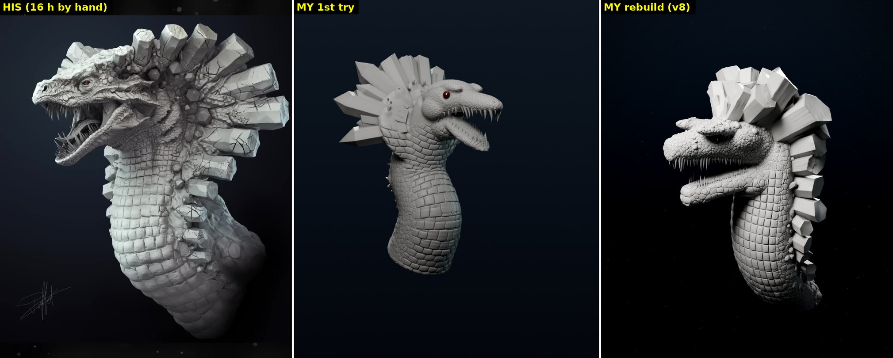

# Blender Expert kit for Claude

A prompt plus a small Python toolkit that make Claude (with the Blender connector) work like an expert creature sculptor. It follows the workflow from David P's ["LEVIATHAN Creature 3D Sculpt (Timelapse)"](https://youtu.be/k-mEz54_p90), whose brushes, settings, modifiers and lighting were read frame by frame from the video.

| File | What it is |
|---|---|
| `PROMPT.md` | The master prompt: quality bar, the artist's pipeline with on-screen settings, phase-by-phase workflow with screenshot checks, and a tested size table. |
| `claude_sculpt_kit.py` | Toolkit Claude uses to sculpt through code: brushes (draw, inflate, grab, crease, smooth), belly plates, scales, skin, teeth, crystals, and a clay/lighting/camera presentation rig. |
| `examples/leviathan_demo.py` | A quick worked example that builds a Leviathan-style bust phase by phase (~60 s). |
| `examples/leviathan_study.py` | A reference-matched rebuild of the artist's design: head and jaws lofted from profiles measured off his turntable, crystal collar, crocodile belly grid, cracks, and his lighting setup. |
| `images/leviathan_rebuild_progress.jpg` | His final render, the first automated try, and the reference-matched rebuild side by side. |
| `images/kit_example_renders.jpg` | Close-ups of what the quick example produces. |

## Setup (once)

1. **Download `claude_sculpt_kit.py`** into your **Downloads** folder. The first time Claude uses it, it finds the file there and installs it into Blender's `scripts/modules` folder.
2. In **Claude Desktop** (Blender connector on), create a **Project** called e.g. "Blender Expert" and paste all of `PROMPT.md` into the project's **instructions**. Optionally add `claude_sculpt_kit.py` and `examples/leviathan_demo.py` to the project's knowledge.
3. Open Blender, start a chat in that project, and describe what you want.

Without a Project, paste `PROMPT.md` at the top of a new chat and write your request after it.

## Example requests

- "A deep-sea anglerfish bust with bioluminescent lures, portfolio render."
- "A dragon head with obsidian horns growing out of cracked basalt plates."
- "A sci-fi helmet with panel lines, vents and battle damage, for a game (under 100k faces)."

Claude starts with a short design brief and a block-out for you to approve, then adds detail in layers, checking screenshots from several angles after every phase.

## What to expect

The biggest jump in quality came from **matching the reference**: measuring proportions from his turntable views, lofting the head from his side profile, and comparing renders side by side after every change (PROMPT.md, Phase 0b). The rebuild follows his design, but his 16-hour hand sculpt is still far richer in wrinkles, skin folds and flowing scales.

Claude sculpts with code, not a stylus. The kit and workflow get much more detail and structure than ad-hoc scripts: layered scales, plates that follow the form, creases, teeth, crystals and a proper clay presentation. A 16-hour hand-sculpted piece by a professional still sets a higher bar for anatomy and nuance. You get the best results by collaborating: approve the block-out, comment on screenshots, and add hero details by hand in Multires where you want them.

Long final renders: Claude previews at low samples, then asks you to press **F12** for the full-quality render rather than blocking Blender.

## Tested

Everything except the live-viewport helpers runs headless on **Blender 4.5.14 LTS** and **5.2.2 LTS**: the bootstrap install from Downloads, every phase of both examples, the Cycles renders, and the automatic switch to Object Mode. `render_preview()` uses Workbench (needs a GPU) or `engine="CYCLES"` as a CPU fallback; only the Cycles path was verified here. `viewport_clay()` and `frame_view()` only act in a live Blender window. Their property names were checked against both versions' API, but they were not run in a live window.
